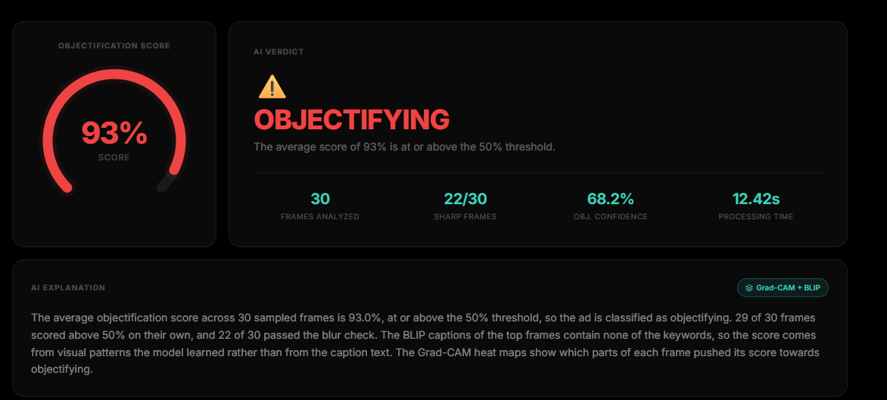
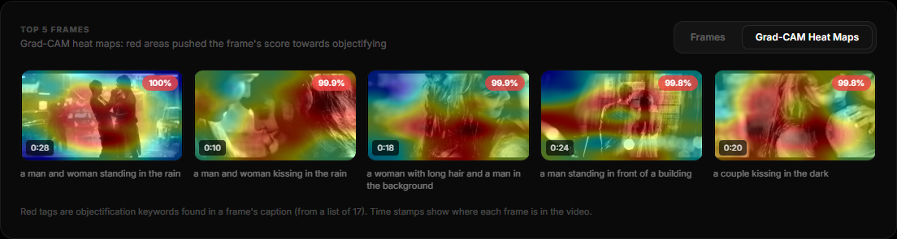
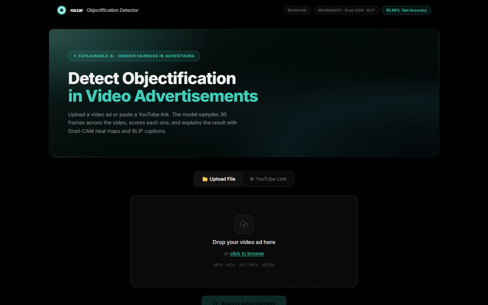
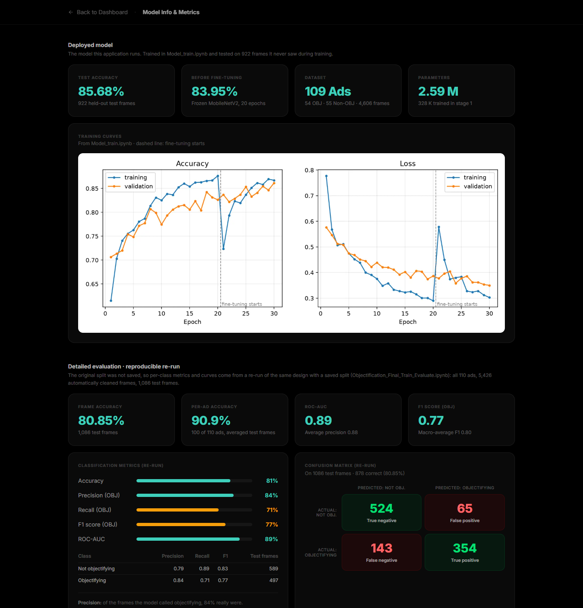

<p align="center">
  
</p>

<h1 align="center">nazar</h1>

<p align="center">
  <b>Explainable detection of objectification of women in video advertisements</b><br>
  MobileNetV2 frame classifier · Grad-CAM heat maps · BLIP captions · Flask API · Next.js dashboard
</p>

*Nazar* is the Hindi and Urdu word for "gaze", and the name of the charm that wards off a harmful one.
Give nazar a video ad (a file or a YouTube link): it scores 30 frames, decides whether the ad objectifies
women, and shows **why**: which frames, which regions (Grad-CAM) and what is in them (BLIP captions).

The deployed model reaches **85.68% test accuracy** on 922 held-out frames (`notebooks/Model_train.ipynb`).
A reproducible re-run of the same design on all 110 ads gives the detailed evaluation: 80.85% frame accuracy,
**90.9% of ads correct** and a **ROC-AUC of 0.89** (`notebooks/Objectification_Final_Train_Evaluate.ipynb`,
`results/metrics.json`). In an additional test, CLIP image features raised the accuracy on the same test frames
to **90.98%** (`experiments/clip_probe`).

M.Tech. (Integrated) mini project, School of Computer Science and Engineering, VIT Chennai (November 2026).

| Result for an advertisement | Top frames with Grad-CAM heat maps |
|---|---|
|  |  |

| Home | Model info and metrics |
|---|---|
|  |  |

---

## What it does

1. Takes a video file **or** a YouTube link
2. Samples up to **30 evenly spaced frames** with OpenCV and resizes them to 224 × 224
3. Checks every frame for blur (Laplacian variance > 100)
4. Scores every frame with the fine-tuned MobileNetV2 (0–100% objectification)
5. Averages the frame scores: **50% or more** (with at least one sharp frame) means **objectifying**
6. Explains the result for the 5 highest-scoring frames:
   - a **Grad-CAM heat map** (where the model looked)
   - a **BLIP caption** (what is in the frame) and a keyword score over 17 objectification keywords

These steps follow equations 1–13 of the paper.

---

## Project structure

```
├── SETUP.bat                       # Windows: one-time setup (needs internet)
├── START_DEMO.bat                  # Windows: start backend + website and open the browser
├── objectification_model.h5        # the deployed model (85.68% run); the backend loads it from here
├── notebooks/
│   ├── Model_train.ipynb                           # training of the deployed model (85.68%)
│   ├── Objectification_Final_Train_Evaluate.ipynb  # reproducible re-run: training + full evaluation
│   ├── Objectification_Metrics.ipynb               # earlier evaluation (its 89.26% is invalid, see below)
│   └── Objectification_DL.ipynb                    # Colab prototype: model + BLIP on uploaded videos
├── data/
│   ├── frames.zip                  # all 8,129 frames extracted from the 110 ads
│   ├── objectifying ads frames.zip # early frame export of the objectifying ads
│   └── cleaned/                    # rule-based cleaning: script, log, frames_cleaned_auto.zip (5,426 frames)
├── models/                         # copy of the deployed model + the re-run model
├── results/                        # output of the re-run notebook: metrics.json, figures, split CSVs
├── demo_videos/                    # sample ads for the live demo (scores in demo_videos/README.md)
├── documents/                      # final_review/ (report, slides), screenshots/, review2/, college_format/
├── backend/
│   ├── app.py              # Flask API server (port 5000)
│   ├── predictor.py        # frames → MobileNetV2 → blur check → Grad-CAM → BLIP → verdict
│   ├── requirements.txt    # exact Python package versions
│   └── START_SERVER.bat    # Windows: install packages and start the server
└── dashboard/
    ├── app/                # Next.js pages: / (analyzer) and /model (metrics)
    ├── components/         # React components
    ├── lib/metrics.ts      # the model's test results, used by every page
    └── public/metrics/     # training curves (deployed model); ROC, PR and confusion matrix (re-run)
```

---

## Requirements

- Windows 10/11 (tested); macOS/Linux should also work
- **Python 3.13, 64-bit, from python.org** (not the Microsoft Store). 3.11 and 3.12 also work;
  **3.14 and newer cannot install TensorFlow 2.21**
- **Node.js 20.9 or newer** (LTS from nodejs.org; tested with Node 24)
- **Git** (or download the ZIP from GitHub)
- About 6 GB of free disk space (Python packages + the BLIP model)
- Internet for the first setup; after that, file uploads work offline

On Windows, run the commands below in **Command Prompt** (cmd), not PowerShell: PowerShell often
blocks `npm` on a new laptop.

---

## Setup and run

### Quick way (Windows): two double-clicks

1. Install **Python 3.13 (64-bit)** from python.org (tick "Add python.exe to PATH") and **Node.js LTS** from nodejs.org.
2. Double-click **`SETUP.bat`** once (needs internet, 15–30 minutes).
3. Double-click **`START_DEMO.bat`** whenever you want to run the demo (no internet needed). It opens
   http://localhost:3000 when everything is ready. Keep the two black windows open.

The manual steps below do the same thing.

### 1. Get the code

```bash
git clone https://github.com/pranaysathish/nazar.git
cd nazar
```

The model file `objectification_model.h5` is part of the repository and stays in the main folder.
Do not move it.

Not in the repository: the frame datasets (`data/frames.zip`, `data/cleaned/frames_cleaned_auto.zip`,
`data/objectifying ads frames.zip`) and the demo videos (`demo_videos/*.mp4`), because they are large and are
copies of third-party advertisements. They are shared separately; any MP4 advertisement works for the demo.

### 2. Start the backend (terminal 1)

Windows (the `py -3.13` launcher makes sure Python 3.13 is used even if other versions are installed):

```bat
cd backend
py -3.13 -m pip install -r requirements.txt
py -3.13 app.py
```

macOS/Linux: the same with `python3.13` instead of `py -3.13`.

The first start downloads the BLIP captioning model (about 1 GB, one time only).
The server is ready when it prints `All models ready` and `Running on http://127.0.0.1:5000`.

### 3. Start the dashboard (terminal 2)

```bash
cd dashboard
npm install
npm run dev
```

Open **http://localhost:3000** in Chrome. Keep both terminals open.

---

## Usage

| Feature | How |
|---|---|
| Analyze a video file | Drag and drop, or click to browse (MP4, MOV, AVI, MKV, WEBM) |
| Analyze a YouTube ad | Click the "YouTube Link" tab and paste the URL (needs internet) |
| See where the model looked | In the results, switch "Top 5 Frames" to "Grad-CAM Heat Maps" |
| View model metrics | Click "Model Info" in the header |

An analysis takes about 15–30 seconds on a laptop CPU.

---

## Tech stack

| Layer | Technology |
|---|---|
| Frame classifier | MobileNetV2, fine-tuned (TensorFlow 2.21 / Keras 3) |
| Explainability | Grad-CAM heat maps, BLIP captions (Salesforce, Hugging Face Transformers 5) |
| Frame extraction | OpenCV |
| YouTube download | yt-dlp (video-only H.264 stream, no ffmpeg needed) |
| Backend API | Flask + Flask-CORS |
| Frontend | Next.js 16 + React 19 + Tailwind CSS 4 |

---

## Model performance

**Deployed model** (`notebooks/Model_train.ipynb`, the model the app uses): trained on 4,606 hand-cleaned frames
from 109 ads; random 80/20 split (2,948 train / 736 validation / 922 test frames).

| Metric | Value |
|---|---|
| Test accuracy after fine-tuning | **85.68%** (922 test frames) |
| Test accuracy before fine-tuning (stage 1 only) | 83.95% |

That run computed only accuracy, and its split was not saved, so the detailed metrics come from a re-run.

**Reproducible re-run** (`notebooks/Objectification_Final_Train_Evaluate.ipynb`, `results/metrics.json`): the same
design on all 110 ads, 5,426 frames after rule-based cleaning (`data/cleaned/README.md`), stratified split saved to
CSV (3,472 / 868 / 1,086), training and evaluation in one session.

| Metric | Value |
|---|---|
| Frame accuracy | **80.85%** (878 / 1,086) |
| Per-ad accuracy (average of each ad's test frames ≥ 0.5) | **90.91%** (100 / 110 ads) |
| Accuracy before fine-tuning (stage 1 only) | 78.27% |
| Majority-class baseline | 54.24% |
| Precision / recall / F1 (objectifying) | 0.84 / 0.71 / 0.77 |
| Precision / recall / F1 (non-objectifying) | 0.79 / 0.89 / 0.83 |
| Macro-average F1 | 0.80 |
| ROC-AUC | **0.89** |
| Average precision | 0.88 |
| Confusion matrix (TN / FP / FN / TP) | 524 / 65 / 143 / 354 |

The two runs used different frame sets and test sets, so their accuracies are not directly comparable.

All metrics are per frame. Frames were split at random, so frames from the same ad can be in both
the training and the test set; results on completely new ads may be lower.

The Review-2 documents quoted 83.95% and 89.26%. 83.95% was the stage-1 accuracy of the deployed model's run, which
reached 85.68% after fine-tuning. 89.26% came from a re-evaluation in a new Colab session
(`Objectification_Metrics.ipynb`) whose file order differed, so most of its "test" frames had been used for
training; it is not a valid test result (the re-run model, for comparison, scores 88.88% on its own training frames).

---

## Troubleshooting

**`ModuleNotFoundError: No module named 'flask'`** — run `py -3.13 -m pip install -r requirements.txt` in `backend/`.

**`No matching distribution found for tensorflow==2.21.0`** — the wrong Python version is being used.
Install Python 3.13 (64-bit) from python.org and use `py -3.13` as shown above.

**`Could not find the DLL(s) 'msvcp140.dll', 'msvcp140_1.dll'`** — install the Microsoft Visual C++
Redistributable 2015–2022 (x64) from Microsoft, then start the server again.

**`npm` is "not digitally signed" / "running scripts is disabled"** — you are in PowerShell; use Command Prompt (cmd) instead.

**Dashboard says "Cannot connect to backend"** — start `py -3.13 app.py` in `backend/` first and wait for `Running on http://127.0.0.1:5000`.

**First analysis is slow / BLIP downloading** — only on the very first run; the model is then cached on disk.

**YouTube link fails** — it needs internet. Some videos are private, age-restricted or blocked;
use "Upload File" with a saved copy of the ad instead.

**`Address already in use`** — another copy of the server is running; close it, or restart the computer.
